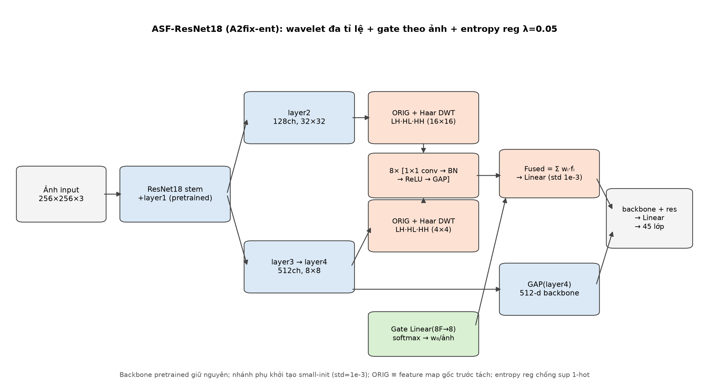

# Phân loại cảnh ảnh viễn thám NWPU-RESISC45

*Multi-scale frequency-gated classification with confusion-guided prototypes and knowledge distillation*

Bài nộp project cuối môn — nhóm 2 thành viên. Repo chứa toàn bộ source, notebook Kaggle, artifacts và tài liệu của 3 vòng nghiên cứu (v1/v2/v3).

> **Mô hình nộp chính:** ResNet18-KD — **96.02% test accuracy**, macro-F1 **96.01%** (+0.65 điểm so cùng kiến trúc huấn luyện CE, nhất quán 3/3 seed), latency 2.53 ms. Ở vòng mở rộng Hướng A (v4), sửa lỗi thiếu `.exp()` trên `logit_scale` giúp **`CMP-exp-CE` đạt 95.49% / 95.48% F1** (vượt CMP v1 +0.39 điểm 3/3 seed và vượt backbone `B1 ResNet18-CE` 95.37% trên cả val lẫn test) và **`CMP-exp-KD` đạt 95.73% / 95.74% ± 0.05%**.

## Tóm tắt

Phân loại 45 cảnh ảnh viễn thám trên **NWPU-RESISC45** (31.500 ảnh 256×256, 45 lớp × 700 ảnh). Hai kiến trúc đề xuất gắn trên cùng backbone ResNet18 ImageNet-pretrained:

- **ASF** (Adaptive Scale–Frequency): tách Haar wavelet mức 1 trên feature maps layer2/layer4 thành 8 thành phần, gate softmax theo từng ảnh hợp nhất qua residual; entropy regularizer giữ gate khỏi sụp 1-hot.
- **CMP / CMP-exp** (Confusion-guided Multi-Prototype): embedding cosine classifier với K=2 prototype mỗi lớp (hard-max, k-means init) — vòng v2 chẩn đoán collapse, vòng v3b phát hiện lỗi thiếu `.exp()` trên `logit_scale` gây trần softmax 13.32%, vòng v4 sửa `κ = exp(θ) ∈ [10, 64]` giúp CMP-exp-CE vượt B1 và mở khóa CMP-KD hội tụ sạch.

**V3 — Knowledge Distillation:** ConvNeXt-T (teacher, val F1 0.9691) huấn luyện cùng ResNet18/ASF với T=4, α=0.5. KD cải thiện nhất quán trên test 3/3 seed cho cả hai student; teacher chỉ dùng lúc training, student inference độc lập.

Đánh giá trên **4.725 ảnh test**, đủ 3 seeds, protocol chống rò rỉ dữ liệu có kiểm chứng (manifest SHA256 khóa toàn dự án).

## Hai kiến trúc tự chế

### ASF — Adaptive Scale–Frequency



- 8 thành phần = nhánh gốc (feature map layer2/layer4) + 3 subband Haar LH/HL/HH mỗi stage.
- Gate theo ảnh học trọng số pha trộn; entropy regularizer λ=0.05 chống sụp 1-hot (v1 không có regularizer đã sụp — xem diagnostics).
- +3.6% tham số so ResNet18; gate phân bố theo ảnh thực sự dưới KD (max_mean 0.46, std LL4 0.26).

### CMP — Confusion-guided Multi-Prototype


- Embedding 512-d L2-normalized; K=2 prototype/lớp; hard-max cosine classifier (theo Sub-center ArcFace), k-means init.
- Confusion graph xây **chỉ từ train** (probe 90/10, 6 epoch): 8 cặp đối xứng đúng ngữ nghĩa (church↔palace, wetland↔lake…).

## Knowledge Distillation (v3)


Teacher ConvNeXt-T chọn theo validation macro-F1 (0.9691, seed 2, checkpoint hash xác minh), frozen, same-view với student. Teacher chỉ xuất hiện lúc training — **student inference độc lập, latency không đổi**.

## Kết quả chính (TEST, 3 seeds — mean ± std)

| Model | Acc % | F1 macro % | Params M | Latency ms |
|---|---|---|---|---|
| B0 SmallCNN | 59.46 ± 0.65 | 59.04 ± 0.64 | 0.29 | 1.54 |
| **B1 ResNet18-CE** | 95.37 ± 0.19 | 95.37 ± 0.19 | 11.20 | 2.52 |
| B2 MobileNetV3-S | 94.69 ± 0.15 | 94.69 ± 0.15 | 1.56 | 4.91 |
| B3 EfficientNet-B0 | 96.08 ± 0.15 | 96.07 ± 0.15 | 4.07 | 7.40 |
| B4 ConvNeXt-T (teacher) | 96.78 ± 0.02 | 96.77 ± 0.02 | 27.85 | 6.87 |
| **ASF-KD** | 95.91 ± 0.14 | 95.91 ± 0.14 | 11.60 | 3.76 |
| **ResNet18-KD** | **96.02 ± 0.20** | **96.01 ± 0.19** | 11.20 | 2.53 |
| **ASF-KD** | 95.91 ± 0.14 | 95.91 ± 0.14 | 11.60 | 3.76 |
| **CMP-exp-KD** *(v4, κ=exp)* | 95.73 ± 0.05 | 95.74 ± 0.05 | 11.49 | 3.71 |
| **CMP-exp-CE** *(v4, κ=exp)* | **95.49 ± 0.22** | **95.48 ± 0.21** | 11.49 | 3.69 |
| ASF-CE | 95.20 ± 0.26 | 95.20 ± 0.26 | 11.60 | 3.82 |
| CMP-CE *(v1)* | 95.10 ± 0.12 | 95.09 ± 0.12 | 11.49 | 2.56 |

Nguồn: `deliverables/results_master.csv` (sinh tự động từ artifacts). Đánh giá test đã được quan sát qua các vòng — v3/v4 công bố là nghiên cứu mở rộng theo plan khóa trước.

**Đọc đúng kết quả:** KD mang cải thiện lớn nhất và nhất quán (+0.65 điểm cho ResNet18, +0.70 điểm cho ASF — 3/3 seed). Ở vòng v4 (Hướng A), sửa `κ = exp(θ)` giúp `CMP-exp-CE` vượt `CMP-CE v1` (+0.39 điểm, 3/3 seed) và vượt `B1 ResNet18-CE` (+0.11 điểm test, 2/3 seed; +0.40 điểm val, 3/3 seed) đồng thời đưa `CMP-exp-KD` từ kẹt 94.48% lên 95.74% ± 0.05%. Dưới KD, `ResNet18-KD` (96.02%) vẫn cao nhất nhóm nhỏ. Không mô hình nhóm nhỏ vượt B4 ConvNeXt-T.

## Đối chiếu yêu cầu môn học

| Yêu cầu | Trạng thái | Bằng chứng |
|---|---|---|
| Hai mô hình tự chế | ✅ | ASF (§ kiến trúc) và CMP (§ kiến trúc) — source [src/models.py](src/models.py) |
| Năm baseline | ✅ | B0–B4 bảng trên + checkpoints `outputs/resisc45-final-baselines-b0-b4-3-seeds/` |
| Dataset ≥ 5 lớp, > 500 ảnh/lớp | ✅ | 45 lớp × 700 ảnh, audit 0 lỗi (`notes/dataset_card.md`) |
| Căn cứ thiết kế | ✅ | `notes/research_plan.md`, diagnostics `notes/v2_diagnostics.json` |
| ACC, Precision, Recall, F1 | ✅ | `deliverables/results_master.csv` (đủ 4 chỉ số, mean ± std 3 seed) |
| Training time + parameters | ✅ | cột Train h + Params M (định nghĩa: wall time gồm validation mỗi epoch, T4) |
| Ứng dụng + inference time | ✅ | [demo/app.py](demo/app.py) — model-only và end-to-end latency phân biệt |
| Mỗi proposed vượt ≥ 1 baseline | ✅ | ASF-CE/KD và CMP-CE/KD đều > B2 (test 3-seed); chi tiết [notes/results_summary.md](notes/results_summary.md) §6 |
| Ablation + negative results | ✅ | 4.1/4.2 + `notes/limitations.md` changelog |
| Tái lập | ✅ | `notes/reproduction.md`, `deliverables/README_REPRODUCE.md` |

**Lưu ý trung thực:** ASF và CMP không vượt B1/B3/B4 về F1 trên test; ưu thế kiến trúc ASF so với backbone chưa được chứng minh trên test (chỉ trên validation). CMP không thắng B1 — chỉ thắng B2.

## Cấu trúc repo

```
├── README.md                    # trang này
├── CLAUDE.md                    # quy ước làm việc với agent
├── src/models.py                # NGUỒN LOGIC DUY NHẤT: models, KD, train, eval, diagnostics
├── notebooks/<slug>/            # mỗi thư mục = 1 kernel Kaggle (nb.py → notebook.ipynb)
│   ├── 010-data-audit           #   audit + split manifest chuẩn
│   ├── 020-pilot                #   pilot timing/sanity
│   ├── 030…050b                 #   screening v1/v2 (baseline, ablation, fix)
│   ├── 060a/060b                #   final training 3 seed
│   ├── 070b/071b/112c           #   evaluation
│   └── 100b/110b/111            #   KD pilot/screening/final
├── scripts/                     # nbmake, push/pull, diagnostics, figures, báo cáo/slides, ZIP
├── demo/app.py                  # Streamlit demo (5 models, top-3, latency)
├── notes/                       # research_plan, registry, diagnostics, limitations, figures
├── deliverables/                # báo cáo DOCX, slides PPTX, results master, ZIP nộp
├── outputs/                     # artifacts pull từ Kaggle (gitignored; khôi phục bằng re-pull)
└── data/                        # dataset raw (gitignored)
```

## Cài đặt và quick start

```bash
# Yêu cầu: uv 0.13+ (Python 3.12 do uv quản lý), tài khoản Kaggle (~/.kaggle/access_token)
uv sync                                   # cài dependencies
uv run kaggle config view                 # kiểm tra credentials

# Demo từ checkpoint có sẵn (cần outputs/ đã pull — xem phần tái lập)
uv run streamlit run demo/app.py

# Build lại notebook từ nguồn nb.py
uv run python3 scripts/nbmake.py notebooks/010-data-audit
```

## Chạy demo

```bash
uv run streamlit run demo/app.py
```

- 5 model options (B1-CE, B1-KD, ASF-CE, ASF-KD best-val, CMP) — checkpoint **chọn theo validation**.
- Upload ảnh → top-3 dự đoán + xác suất; phân biệt **model-only latency** và **end-to-end latency**.
- 7 tùy chọn corruption tổng hợp minh họa; teacher không xuất hiện trong inference; chạy hoàn toàn offline.
- Nếu thiếu checkpoint: app hiển thị đường dẫn cần pull (lệnh `pull_output.sh` tương ứng trong `notes/reproduction.md`).

## Tái lập thí nghiệm

Toàn bộ chạy trên Kaggle GPU (Tesla T4), tổng ~16 giờ qua 3 vòng. Thứ tự kernel, metadata và quy tắc:

| # | Thư mục notebook | Kernel | GPU | Mục đích |
|---|---|---|---|---|
| 1 | `010-data-audit` | resisc45-data-audit-split-manifest | CPU | audit + split manifest chuẩn |
| 2 | `020-pilot` → `020-pilot-v2` | resisc45-pilot-v2-local-stage | T4 | timing + sanity |
| 3 | `030-baselines` | resisc45-screen-baselines-b0-b4 | T4 | screening baselines |
| 4 | `040-asf-ablation` → `040b-asf-fix` | resisc45-screen-asf-* | T4 | ablation ASF + fix |
| 5 | `050-cmp-ablation` → `050b-cmp-fix` | resisc45-screen-cmp-* | T4 | ablation CMP + fix |
| 6 | `060a-final-baselines` | resisc45-final-baselines-b0-b4-3-seeds | T4 | final v1 baselines |
| 7 | `060b-final-proposed` | resisc45-final-proposed-asf-cmp-3-seeds | T4 | final v1 proposed |
| 8 | `070-final-evaluation` → `070b-final-evaluation` | resisc45-final-evaluation-v2-offline | T4 | test + robustness v1 |
| 9 | `080-cmp-v2`, `090-asf-v2` | resisc45-screen-*-v2/v3 | T4 | screening v2 |
| 10 | `100b-kd-pilot`, `110b-kd-screen`, `111-kd-final` | resisc45-kd-* | T4 | KD pilot/screening/final |
| 11 | `071b-eval-3seed`, `112c-eval-kd-3seed` | resisc45-expanded-eval-* / resisc45-eval-kd-3-seeds-v2 | T4 | test eval mở rộng |
| 12 | `120-h1a-screen`, `121-cmp-exp-final-eval` | resisc45-h1a-screen-* / resisc45-cmp-exp-3-seeds-and-test-eval | T4 | Hướng A (v4): CMP κ=exp 3-seed + test eval |

```bash
./scripts/push_kernel.sh notebooks/<slug>            # push (cần xác nhận)
./scripts/kernel_status.sh dangbang1/<kernel-slug>   # poll — slug THEO TITLE, xem URL kernel
./scripts/pull_output.sh dangbang1/<kernel-slug>     # pull artifacts → outputs/<slug>/
```

Chi tiết đầy đủ: [notes/reproduction.md](notes/reproduction.md) và [deliverables/README_REPRODUCE.md](deliverables/README_REPRODUCE.md).

## Bộ tài liệu nộp

`deliverables/`:
- **Bao_cao_cuoi_mon_NWPU_RESISC45.docx** — báo cáo đầy đủ 19 mục
- **Slides_cuoi_mon_NWPU_RESISC45.pptx** — 19 slides kèm speaker notes
- **Bao_cao_ket_qua_nghien_cuu.md** — báo cáo kết quả nghiên cứu chi tiết (markdown)
- **results_master.json / .csv** — bảng số liệu chuẩn (nguồn duy nhất cho mọi bảng)
- **manifest.json** — SHA256 của 12 checkpoint/artifact nguồn
- **NWPU_RESISC45_submission.zip** — gói nộp sạch (3.2 MB, 46 files)

## Hạn chế

- Một dataset; chưa kiểm chứng dataset thứ hai.
- Test đã quan sát qua các vòng — kết quả test v3 công bố là nghiên cứu mở rộng.
- 3 seed là mẫu nhỏ; không dùng kiểm định tương đương để tuyên bố hai mô hình "như nhau".
- Robustness là corruption tổng hợp trong phòng, không đại diện deployment.
- ASF/CMP không vượt B1 về F1 test; KD là nhân tố cải thiện chính (chi phí: teacher online ~2× thời gian/epoch — [notes/results_summary.md](notes/results_summary.md) §V3).

## Tài liệu tham khảo chính

1. G. Cheng et al. *Remote Sensing Image Scene Classification: Benchmark and State of the Art*. Proc. IEEE 2017. arXiv:1703.00121.
2. S. E. Finder et al. *Wavelet Convolutions for Large Receptive Fields*. ECCV 2024. arXiv:2407.05848.
3. H. Wang et al. *CosFace*. CVPR 2018 · Y. An et al. *Sub-center ArcFace*. ECCV 2020 · Q. Qian et al. *SoftTriple Loss*. ICCV 2019.
4. L. Beyer et al. *Knowledge Distillation: A Good Teacher Is Patient and Consistent*. CVPR 2022 · B. Zhao et al. *Decoupled Knowledge Distillation*. CVPR 2022.
5. Z. Qin et al. *FcaNet*. ICCV 2021 · H. Chen et al. *Knowledge Review*. CVPR 2021.
6. Y. Wan et al. *FSPA-Net*. KBS 2026 · N. Liu et al. *GDPNet*. IEEE 2025 — prior art RS được đối chiếu phạm vi.

Danh sách đầy đủ và kiểm tra nguồn: [notes/related_work.md](notes/related_work.md).
