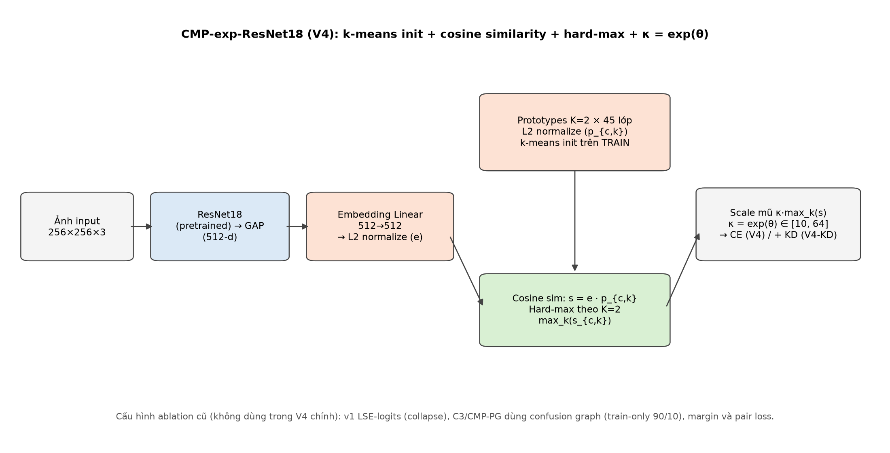
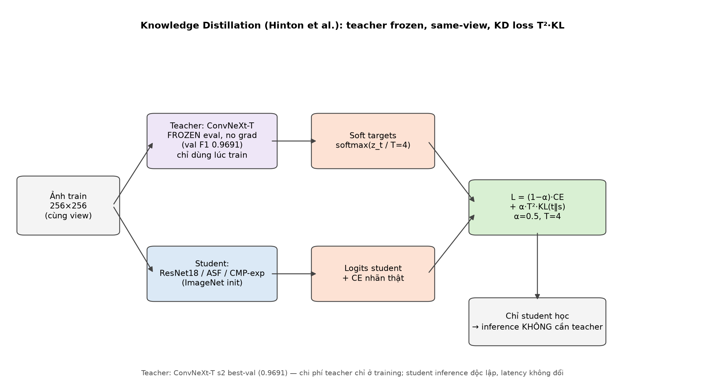

# Phân loại cảnh ảnh viễn thám NWPU-RESISC45

*Multi-scale frequency-gated classification, multi-prototype cosine classifier và knowledge distillation*

Bài nộp project cuối môn — nhóm 2 thành viên. Repo chứa toàn bộ source, notebook Kaggle, scripts kiểm chứng/đóng gói, artifacts báo cáo và tài liệu của 4 vòng nghiên cứu (`v1`–`v4`).

> **Kết quả chính (TEST, 4.725 ảnh, trung bình 3 seeds `{0, 1, 2}`):** Hai kiến trúc tự chế ở chế độ chuẩn CE là **`ASF-CE` (95.20% Acc / 95.20% macro-F1)** và **`CMP-exp-CE` (95.49% Acc / 95.48% macro-F1)** đều vượt baseline **`B2 MobileNetV3-S` (94.69% Acc / 94.69% macro-F1)**; riêng `CMP-exp-CE` vượt nhẹ `B1 ResNet18-CE` (`95.37%`) trung bình `+0.11` điểm phần trăm (dương ở `2/3` seed). Ở phần mở rộng **Knowledge Distillation (KD)**, **`ResNet18-KD`** (đối chứng trên backbone chuẩn) đạt **96.02% Acc / 96.01% macro-F1**, **`ASF-KD`** đạt **95.91% Acc / 95.91% macro-F1**, và **`CMP-exp-KD`** đạt **95.73% Acc / 95.74% macro-F1**.

## Tóm tắt

Phân loại 45 cảnh ảnh viễn thám trên **NWPU-RESISC45** (31.500 ảnh RGB 256×256, 45 lớp × 700 ảnh). Hai kiến trúc đề xuất gắn trên cùng backbone ResNet18 ImageNet-pretrained:

- **ASF** (Adaptive Scale–Frequency): giữ nguyên backbone pretrained; tách Haar wavelet mức 1 trên `layer2` (`32×32`) và `layer4` (`8×8`) thành 8 thành phần (`ORIG` + 3 subband `LH/HL/HH` mỗi stage); gate softmax theo từng ảnh hợp nhất qua residual với entropy regularizer `λ = 0.05` chống sụp 1-hot.
- **CMP-exp** (Confusion-guided Multi-Prototype, cấu hình V4): embedding 512-d L2-normalized, `K = 2` prototype/lớp khởi tạo bằng k-means trên tập train, cosine similarity, hard-max theo `K` và scale mũ `κ = exp(θ)` (khởi tạo `κ = 10`, chặn trên `64`). Các thành phần confusion graph, margin và pair loss được khảo sát ở vòng ablation (`C3`/`CMP-PG`) và không dùng trong cấu hình V4 chính.
- **Mở rộng KD (v3/v4):** Teacher `ConvNeXt-T` (seed 2, val macro-F1 `0.9691`, SHA256 `9627ca43…`, frozen) huấn luyện cùng student ở `T = 4, α = 0.5`; teacher chỉ xuất hiện lúc training, inference của student hoàn toàn độc lập.

Đánh giá trên **4.725 ảnh test**, đủ 3 seeds `{0, 1, 2}`, protocol chống rò rỉ dữ liệu có kiểm chứng (`split_manifest.csv` SHA256 `cc70020a…`).

## Hai kiến trúc đề xuất

### ASF — Adaptive Scale–Frequency


- 8 thành phần = feature map gốc (`ORIG`) + 3 subband Haar `LH/HL/HH` ở `layer2` (`128ch, 32×32 → 16×16`) và `layer4` (`512ch, 8×8 → 4×4`).
- Gate theo ảnh học trọng số pha trộn; entropy regularizer `λ = 0.05` chống sụp 1-hot (v1 không có regularizer đã sụp về `ORIG4`).
- `+3.6%` tham số (`11.60M` vs `11.20M`); trên validation cải thiện `3/3` seed (`+0.39` điểm), nhưng trên test 3-seed không vượt `B1` (`95.20%` vs `95.37%`).

### CMP-exp — Multi-Prototype Cosine Classifier (V4)



- Embedding 512-d L2-normalized; `K = 2` prototype/lớp khởi tạo k-means trên tập train; hard-max cosine similarity và scale mũ `κ = exp(θ) ∈ [10, 64]`.
- V1–v3b chẩn đoán nguyên nhân thất bại của CMP cũ (quên `.exp()` trên `logit_scale` khiến `κ ≤ 4.605`, dẫn tới trần softmax `13.32%` ở `κ = 3.823, T = 4` cho `CMP-KD` cũ; margin v1 ngược chiều; LSE gây prototype collapse). Cấu hình V4 (`κ = exp(θ)` + hard-max + k-means init) giải quyết đồng bộ các nút thắt đó.
- Confusion graph xây chỉ từ train (`probe 90/10`, 6 epoch) được trình bày trong phần ablation (`C3`/`CMP-PG`).

## Knowledge Distillation (Mở rộng v3/v4)



Teacher `ConvNeXt-T` (chọn theo validation macro-F1 `0.9691`, seed 2) đặt ở chế độ frozen eval, same-view với student. Mọi mô hình cả CE lẫn KD đều chạy đủ **15 epoch** ở cả 3 seed; thời gian huấn luyện KD tăng ~`2×` (`~0.38–0.40h` vs `~0.20–0.21h`) hoàn toàn do forward pass online của teacher.

## Kết quả chính (TEST, 3 seeds — mean ± std)

Nguồn duy nhất: [deliverables/results_master.csv](deliverables/results_master.csv) và [deliverables/results_master.json](deliverables/results_master.json). Latency đo bằng median `batch = 1`, `256×256`, `Tesla T4 (cuda)`, `n_warmup = 10`, `n_iter = 50` (trung bình 3 seed theo từng phiên `071b`/`112c`/`121`). Thời gian train là wall time của `train_model` (15 epoch); với `CMP-exp`, khởi tạo k-means đo riêng là `~44.7s` (`0.012h`) cho CE và `~42.0s` (`0.012h`) cho KD.

### Bảng A — Năm baseline và hai mô hình đề xuất (chế độ CE chuẩn)

| Model | Vai trò | Test Acc % | Test Macro-F1 % | Params M | Train h | Latency ms (3-seed) |
|---|---|---:|---:|---:|---:|---:|
| B0 SmallCNN | Baseline (từ đầu) | 59.46 ± 0.65 | 59.04 ± 0.64 | 0.29 | 0.344 | 1.54 *(071b)* |
| B2 MobileNetV3-S | Baseline đối chiếu yêu cầu | 94.69 ± 0.15 | 94.69 ± 0.15 | 1.56 | 0.180 | 4.91 *(071b)* |
| **B1 ResNet18-CE** | Baseline cùng backbone | 95.37 ± 0.19 | 95.37 ± 0.19 | 11.20 | 0.200 | 2.52 *(071b)* / 4.11 *(cùng máy 121)* |
| B3 EfficientNet-B0 | Baseline | 96.08 ± 0.15 | 96.07 ± 0.15 | 4.07 | 0.331 | 7.40 *(071b)* |
| B4 ConvNeXt-T | Baseline trần / Teacher | **96.78 ± 0.02** | **96.77 ± 0.02** | 27.85 | 0.616 | 6.87 *(071b)* |
| **ASF-CE** | Đề xuất 1 (CE chuẩn) | 95.20 ± 0.26 | 95.20 ± 0.26 | 11.60 | 0.209 | 3.82 *(071b)* |
| CMP-CE *(v1)* | Đề xuất 2 (bản cũ) | 95.10 ± 0.12 | 95.09 ± 0.12 | 11.49 | 0.197 | 2.80 *(071b)* |
| **CMP-exp-CE** *(v4)* | **Đề xuất 2 (cấu hình V4)** | **95.49 ± 0.22** | **95.48 ± 0.21** | 11.49 | 0.198 *(+0.012h km)* | 3.69 *(121, RN18 cùng máy: 4.11)* |

### Bảng B — Nghiên cứu mở rộng Knowledge Distillation (v3/v4)

| Model | Vai trò | Test Acc % | Test Macro-F1 % | Params M | Train h | Latency ms (3-seed) |
|---|---|---:|---:|---:|---:|---:|
| **ResNet18-KD** | Đối chứng KD trên backbone chuẩn | **96.02 ± 0.20** | **96.01 ± 0.19** | 11.20 | 0.384 | 2.53 *(112c)* |
| **ASF-KD** | Mở rộng KD của ASF | 95.91 ± 0.14 | 95.91 ± 0.14 | 11.60 | 0.398 | 3.76 *(112c)* |
| **CMP-exp-KD** *(v4)* | Mở rộng KD của CMP-exp | 95.73 ± 0.05 | 95.74 ± 0.05 | 11.49 | 0.390 *(+0.012h km)* | 3.71 *(121, RN18 cùng máy: 4.11)* |

**Đọc đúng kết quả (macro-F1 ghép cặp theo seed `{0, 1, 2}`):**
- **Đáp ứng yêu cầu môn học:** Cả hai mô hình tự chế ở chế độ CE chuẩn đều vượt `B2 MobileNetV3-S` (`94.69%`): `ASF-CE` hơn **+0.51 điểm** (`95.20%`) và `CMP-exp-CE` hơn **+0.79 điểm** (`95.48%`).
- **So với backbone `B1 ResNet18-CE` (`95.37%`):** `ASF-CE` chưa vượt B1 trên test (`-0.16` điểm, dương `1/3` seed, dù thắng `3/3` seed trên validation `+0.39` điểm). Cấu hình V4 **`CMP-exp-CE`** vượt `CMP-CE (v1)` **+0.39 điểm** (`3/3` seed) và vượt nhẹ `B1 ResNet18-CE` **+0.11 điểm** (dương ở `2/3` seed test: `+0.42, -0.34, +0.26`; dương `3/3` seed validation `+0.40` điểm). Lưu ý hiệu năng tăng của `CMP-exp-CE` là kết quả của **gói cấu hình V4** (scale mũ + hard-max + k-means init).
- **Mở rộng KD:** Cải thiện `94.48% → 95.61%` là so sánh **validation tại seed 0** giữa `CMP-KD (v3)` cũ và `CMP-exp-KD (v4)`; trên **test 3-seed**, `CMP-exp-KD` đạt **95.74%** (hơn `CMP-exp-CE` `+0.26` điểm, `3/3` seed). `ResNet18-KD` (`96.01%`) giữ vai trò đối chứng KD trên backbone chuẩn và là mô hình nhóm nhỏ có macro-F1 cao nhất; `ASF-KD` (`95.91%`) không vượt `ResNet18-KD`. Không mô hình nhóm nhỏ nào vượt `B4 ConvNeXt-T` (`96.77%`).

## Đối chiếu yêu cầu môn học

| Yêu cầu | Trạng thái | Bằng chứng |
|---|---|---|
| Hai mô hình tự chế | ✅ | `ASF-CE` và `CMP-exp-CE` — source [src/models.py](src/models.py) |
| Năm baseline | ✅ | B0–B4 bảng A + reports `outputs/resisc45-final-baselines-b0-b4-3-seeds/` |
| Dataset ≥ 5 lớp, > 500 ảnh/lớp | ✅ | 45 lớp × 700 ảnh, audit 0 lỗi ([notes/dataset_card.md](notes/dataset_card.md)) |
| Căn cứ thiết kế | ✅ | [notes/research_plan.md](notes/research_plan.md), [notes/v2_diagnostics.json](notes/v2_diagnostics.json) |
| ACC, Precision, Recall, F1 | ✅ | [deliverables/results_master.csv](deliverables/results_master.csv) (đủ 4 chỉ số, 3 seeds) |
| Training time + parameters | ✅ | Cột Train h (15 epoch, tách riêng `kmeans-init` cho CMP-exp) + Params M |
| Ứng dụng + inference time | ✅ | [demo/app.py](demo/app.py) — tách model-only (forward sau warm-up) và app end-to-end |
| Mỗi proposed vượt ≥ 1 baseline | ✅ | `ASF-CE` (`+0.51` pts) và `CMP-exp-CE` (`+0.79` pts) đều > B2 (`94.69%`) |
| Ablation + negative results | ✅ | `040/050/080/090/110b/120` + [notes/limitations.md](notes/limitations.md) |
| Tái lập | ✅ | [notes/reproduction.md](notes/reproduction.md), [deliverables/README_REPRODUCE.md](deliverables/README_REPRODUCE.md) |

## Cấu trúc repo / gói nộp

```text
├── README.md                    # trang này
├── pyproject.toml, uv.lock      # khóa môi trường Python 3.12 + dependencies (uv sync)
├── src/models.py                # nguồn logic duy nhất: models, KD, train, eval
├── notebooks/<slug>/            # mỗi thư mục = 1 kernel Kaggle (nb.py + kernel-metadata.json)
├── scripts/                     # nbmake, build_results_master, validate_submission, make_*, demo_smoke
├── demo/app.py                  # Streamlit demo (7 models, top-3, model-only vs app e2e latency)
├── tests/                       # unit & checkpoint regression tests (pytest)
├── notes/                       # kế hoạch, registry, diagnostics, limitations, figures/*.png
├── deliverables/                # DOCX, PPTX, results_master.*, manifest.json, báo cáo md, ZIP
└── outputs/                     # JSON/CSV reports nhỏ (trong ZIP) + checkpoints .pt lớn (pull riêng)
```

## Cài đặt, kiểm tra và chạy demo

```bash
# Yêu cầu: uv 0.13+ (Python 3.12)
uv sync

# Kiểm tra số liệu + tính toàn vẹn (đọc reports trong outputs/)
uv run python3 scripts/validate_submission.py

# Smoke-test 7 model trên checkpoint thật (khi có outputs/*.pt và data/raw)
uv run python3 scripts/demo_smoke.py

# Chạy giao diện Streamlit offline (cần checkpoints trong outputs/ — xem deliverables/README_REPRODUCE.md)
uv run --with streamlit streamlit run demo/app.py
```

## Tái lập thí nghiệm trên Kaggle

Toàn bộ chạy trên Kaggle GPU (Tesla T4), tổng ~18.5 giờ qua 4 vòng (`v1`–`v4`). Thứ tự kernel và lệnh tái lập chi tiết nằm ở [notes/reproduction.md](notes/reproduction.md) và [deliverables/README_REPRODUCE.md](deliverables/README_REPRODUCE.md).

## Bộ tài liệu nộp

Thư mục [deliverables/](deliverables/):
- **Bao_cao_cuoi_mon_NWPU_RESISC45.docx** — báo cáo cuối môn đầy đủ
- **Slides_cuoi_mon_NWPU_RESISC45.pptx** — 19 slides kèm speaker notes
- **Bao_cao_ket_qua_nghien_cuu.md** — báo cáo chi tiết markdown
- **results_master.json / .csv** — bảng số liệu chuẩn (nguồn duy nhất)
- **manifest.json** — SHA256 của 18 checkpoint/artifact nguồn
- **README_REPRODUCE.md** — hướng dẫn tái lập, vị trí & hash các checkpoint `.pt` lớn nằm ngoài ZIP
- **NWPU_RESISC45_submission.zip** — gói nộp cuối đã kiểm chứng từ thư mục sạch

## Hạn chế

- Chỉ đánh giá trên một dataset (`NWPU-RESISC45`), chưa kiểm chứng chéo trên dataset thứ hai.
- Tập test đã được quan sát qua các vòng (`v1`–`v4`) — các kết quả mở rộng công bố minh bạch kèm kế hoạch khóa trước (`notes/final_plan*.json`).
- Cỡ mẫu 3 seeds là nhỏ; không dùng kiểm định tương đương để tuyên bố hai mô hình "như nhau".
- Robustness là corruption tổng hợp trong phòng (`070b`, 1 best-val checkpoint/model), không đại diện deployment thực tế.
- Thư mục `.pt` checkpoints lớn (~2 GB tổng) không đóng gói trong ZIP; cần tải từ Kaggle theo hướng dẫn tại [deliverables/README_REPRODUCE.md](deliverables/README_REPRODUCE.md) nếu muốn chạy lại UI demo hoặc kiểm tra trọng số.

## Tài liệu tham khảo chính

1. G. Cheng et al. *Remote Sensing Image Scene Classification: Benchmark and State of the Art*. Proc. IEEE 2017. arXiv:1703.00121.
2. S. E. Finder et al. *Wavelet Convolutions for Large Receptive Fields*. ECCV 2024. arXiv:2407.05848.
3. H. Wang et al. *CosFace*. CVPR 2018 · Y. An et al. *Sub-center ArcFace*. ECCV 2020 · Q. Qian et al. *SoftTriple Loss*. ICCV 2019.
4. L. Beyer et al. *Knowledge Distillation: A Good Teacher Is Patient and Consistent*. CVPR 2022 · B. Zhao et al. *Decoupled Knowledge Distillation*. CVPR 2022.
5. Z. Qin et al. *FcaNet*. ICCV 2021 · H. Chen et al. *Knowledge Review*. CVPR 2021.
6. Y. Wan et al. *FSPA-Net*. KBS 2026 · N. Liu et al. *GDPNet*. IEEE 2025 — prior art RS được đối chiếu phạm vi.

Danh sách đầy đủ và kiểm tra nguồn: [notes/related_work.md](notes/related_work.md).
